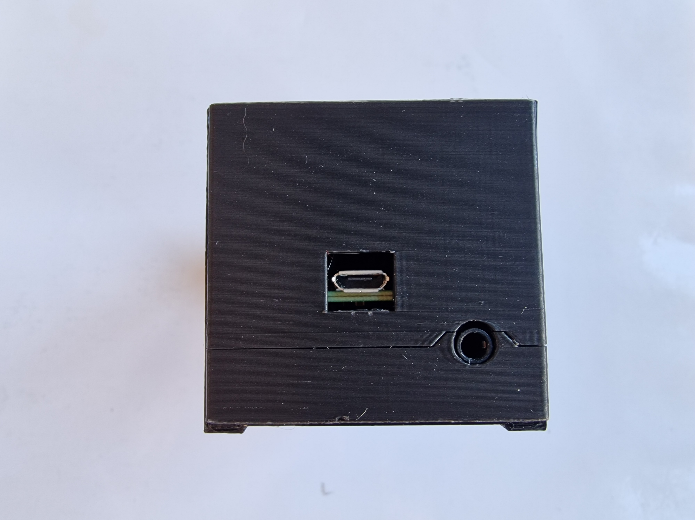
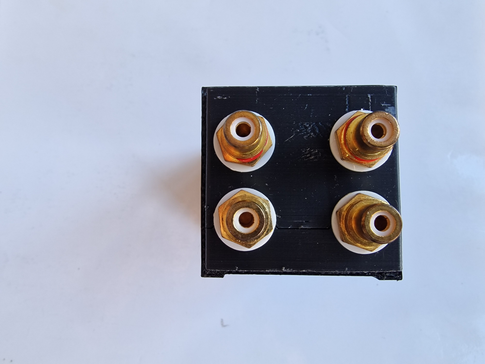
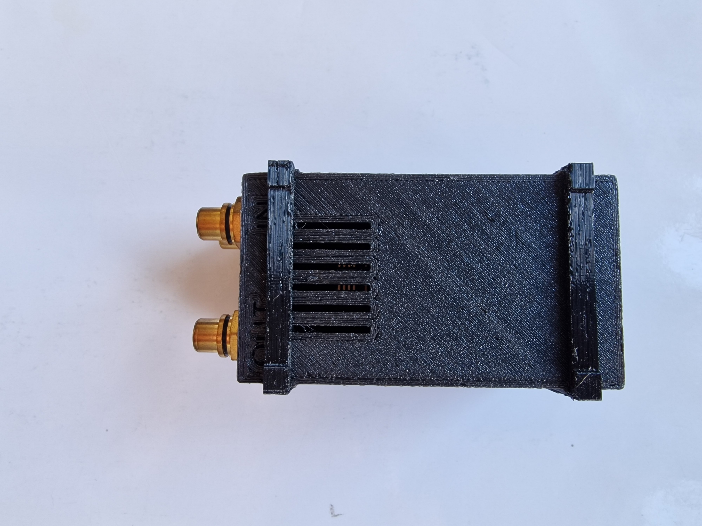
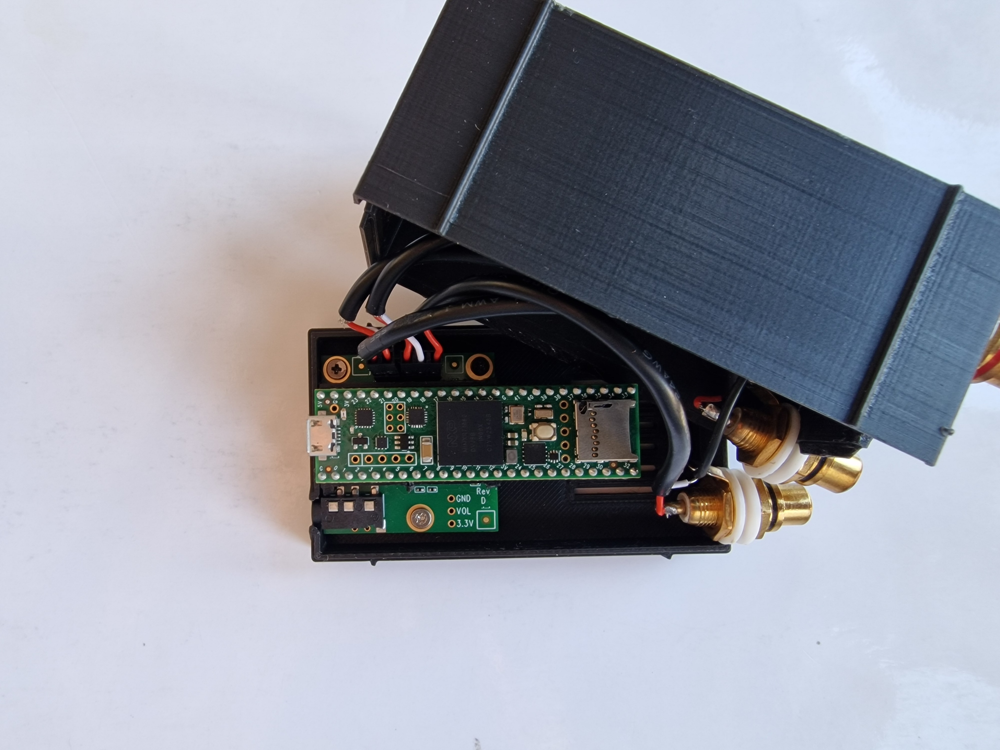

# Branchements & pilotage des paramètres

## Le boîtier

La Teensy et son Audio Shield sont montés dans un **boîtier imprimé en 3D**. Rien à câbler : tout
est déjà relié en interne, vous ne manipulez que les connecteurs des deux faces.

### Face avant : USB et casque



| Connecteur | Rôle |
|---|---|
| **USB micro-B** | alimentation, téléversement, Moniteur série, MIDI **et** audio USB — tout passe par ce seul câble |
| **Jack 3,5 mm** | sortie casque (`HP OUT` du SGTL5000) |

### Face arrière : les 4 RCA



Les quatre RCA forment une matrice 2 × 2. **En regardant la face arrière**, la colonne de
**gauche** est la **sortie**, celle de **droite** l'**entrée** ; la **rangée du haut** porte une
**bague rouge** (canal droit), celle du bas n'en a pas (canal gauche) :

| | Colonne gauche — **OUT** | Colonne droite — **IN** |
|---|---|---|
| **Rangée haute** (bague rouge) | `LINE OUT` **R** | `LINE IN` **R** |
| **Rangée basse** (sans bague) | `LINE OUT` **L** | `LINE IN` **L** |

En cas de doute, les mentions **`IN`** et **`OUT`** sont gravées sur le plateau inférieur du
boîtier, juste sous les connecteurs concernés :



Les deux RCA d'entrée arrivent sur le `LINE IN` du codec : c'est ce que lit `AudioInputI2S`. Les
deux RCA de sortie et le jack casque sont alimentés par le même DAC, ils délivrent donc le **même
signal** — on peut écouter au casque tout en envoyant la sortie ligne vers un oscilloscope ou la
carte son du PC, ce qui est exactement le montage de mesure du TP1.

### À l'intérieur



Rien de plus que le montage décrit ci-dessous : la Teensy est enfichée sur l'Audio Shield, et
quatre paires de fils relient les pastilles `LINE IN` / `LINE OUT` de la carte aux RCA de la face
arrière. Le boîtier s'ouvre en retirant le capot, ce qui donne accès au bouton **PROGRAM** de la
Teensy si un téléversement se bloque.

### Fonctionnement autonome (standalone)

Une fois le sketch téléversé, **le boîtier n'a plus besoin du PC** : il suffit de l'alimenter en
5 V par sa prise USB (chargeur de téléphone, batterie externe, port USB quelconque). Le programme
redémarre seul, l'effet tourne, on branche une source sur les RCA d'entrée et un casque sur le
jack. C'est un vrai petit processeur d'effets posable sur une table.

Deux conséquences à garder en tête :

- **L'entrée doit être analogique.** Sans PC, `AudioInputUSB` ne reçoit aucun échantillon (et sort
  du silence). Les TP du Jour 2 sont écrits pour l'entrée USB : pour les faire tourner en
  autonome, remplacer `AudioInputUSB` par `AudioInputI2S` et brancher la source sur les RCA.
- **Les paramètres ne sont plus réglables.** Sans le pupitre MIDI, ils gardent les valeurs fixées
  dans `setup()` (au Jour 2, ils y sont de toute façon : pas de MIDI). C'est d'ailleurs une bonne raison d'y écrire des valeurs par défaut musicalement
  correctes plutôt que des zéros.

## Audio Shield sur Teensy 4.x

L'Audio Shield Rev D se **superpose** à la Teensy (mêmes broches). Il utilise :

- **I2S** (données audio) : broches 7, 8, 20, 21, 23
- **I2C** (contrôle du SGTL5000) : broches 18 (SDA), 19 (SCL)
- **MCLK** : broche 23

Entrées/sorties audio de la carte, ramenées sur les connecteurs du boîtier :

- **LINE IN** (entrée ligne) — utilisée au **Jour 1** (mesures à l'oscilloscope) ;
- **HP OUT** (casque) et **LINE OUT** — sortie, dans les deux journées.

> Au **Jour 2**, l'entrée n'est plus analogique : le son vient du PC par l'**USB**
> (`AudioInputUSB`). Voir le planning du Jour 2.

## Schéma de la chaîne audio

**Jour 1 (analogique)**

```
LINE IN → [SGTL5000 ADC] → I2S → [Teensy : Audio Library] → I2S → [SGTL5000 DAC] → HP OUT
```

**Jour 2 (USB)**

```
PC (musique) → USB → [Teensy : Audio Library] → I2S → [SGTL5000 DAC] → HP OUT
```

---

## Pilotage des paramètres : MIDI, pas de potentiomètres

Aucun câblage n'est nécessaire pour régler les paramètres des effets (gain, coupure, Q, retard,
drive, seuil…). Tout passe par le **MIDI USB**, sur le **même câble** que l'audio :

1. Dans l'IDE : *Outils → USB Type →* **« Serial + MIDI + Audio »**
   (cette variante conserve le **Moniteur série** pour les affichages).
2. Téléverser le sketch, puis ouvrir [`pupitre_midi.html`](../logiciels/pupitre_midi.html)
   dans **Chrome** ou **Edge** (le Web MIDI n'est pas supporté par Safari/Firefox).
3. Dans le pupitre : choisir la sortie **« Teensy MIDI/Audio »** et le **preset du TP**.
4. Bouger les faders : chaque mouvement envoie un **Control Change** (0–127) que la Teensy
   convertit en valeur physique.

### Comment ça marche côté code

Le fichier [`midi_map.h`](../../code/jour1/TP2_gain/midi_map.h) (copié dans chaque dossier de sketch) fournit quatre
fonctions de conversion, **alignées sur les plages affichées par le pupitre** :

```cpp
midiLin(val, lo, hi)   // interpolation linéaire      (gain, seuil, mix…)
midiLog(val, lo, hi)   // interpolation logarithmique (fréquences, temps)
midiBool(val)          // interrupteur : vrai si val >= 64
midiStep(val, n)       // sélecteur à n positions : 0..n-1 (TP avancés)
```

Le sketch enregistre un *callback* et lit le MIDI dans `loop()` :

```cpp
void onControlChange(byte canal, byte cc, byte val) {
  switch (cc) {
    case 74: fc = midiLog(val, 40.0f, 20000.0f); applyFilter(); break;
    // ...
  }
}

void setup() { /* ... */ usbMIDI.setHandleControlChange(onControlChange); }
void loop()  { usbMIDI.read(); /* ... */ }
```

> ⚠️ `usbMIDI.read()` doit être appelé dans `loop()`, sinon **aucun message n'est traité** et
> les faders semblent sans effet. C'est le premier réflexe de dépannage.

### Table des Control Change par TP

| TP | CC | Paramètre | Plage | Loi |
|---|---|---|---|---|
| TP2 | 7 / 80 / 81 | gain / bypass / mute | 0–4 · 0/127 · 0/127 | lin · bouton · bouton |
| TP3 | 74 / 71 / 81 | coupure / Q / mode LP-HP | 40–20000 Hz · 0,5–10 · 0/127 | log · lin · bouton |
| TP4–TP6 | — | pas de MIDI : réglages dans `setup()`, observation à l'oscilloscope | — | — |
| A2 | 21 / 24 / 29 | niveau source / fréq. sinus / bande de mesure | −60–0 dBFS · 200–10000 Hz · 1–20 kHz | lin · log · log |
| A2 | 25 / 26 / 27 / 28 | bits B / mise en forme / CAN ΣΔ / OSR | {2…16} · {0, 1, 2} · {arrêt, 1, 2} · {16, 32, 64} | sélecteur |
| A2 | 81 / 82 / 83 | source USB / dither / flux 1 bit broche 2 | 0/127 | bouton |

La table complète et commentée figure aussi en tête de [`midi_map.h`](../../code/jour1/TP2_gain/midi_map.h).

Le pupitre propose en plus un preset **Générique (CC 20–27)**, utile pour piloter un effet
personnel sans avoir à ajouter un preset dédié.

> Les presets du pupitre et cette table doivent rester alignés sur
> [`midi_map.h`](../../code/jour1/TP2_gain/midi_map.h). Si vous ajoutez un effet, ajoutez-le aux trois endroits.

### TP avancé A2 : sortie 1 bit sur la broche 2

La partie 3 du TP A2 détourne le second port audio série (SAI2, `AudioOutputTDM2`) pour émettre
un flux sigma-delta 1 bit à **11,29 MHz** sur la **broche 2** de la Teensy (broches 3 = FS,
4 = BCLK, 33 = MCLK ; aucune n'est utilisée par l'Audio Shield). Le boîtier doit être ouvert
pour accéder à la broche 2 et à une masse. Filtre de reconstruction :

```
broche 2 --[1 kΩ]--+--[10 kΩ]--+---> oscilloscope (sonde ×10)
                  4,7 nF      470 pF
                   |           |
GND ---------------+-----------+
```

Sortie attendue : 1,65 V continu ± 1,32 V à 0 dBFS. **Ne pas brancher de casque** directement.
Cette partie est **à valider sur carte** (principe vérifié en simulation uniquement).

### Dépannage

| Symptôme | Piste |
|---|---|
| Les faders n'ont aucun effet | `usbMIDI.read()` absent de `loop()` |
| Aucun port « Teensy MIDI » dans le pupitre | USB Type ≠ « Serial + MIDI + Audio » ; retéléverser |
| « Web MIDI indisponible » | navigateur non-Chromium → utiliser Chrome ou Edge |
| Valeur affichée ≠ effet entendu | plage du code différente de celle du pupitre : comparer avec `midi_map.h` |
| Réglage qui « escalade » (crépite) | résolution 7 bits (128 pas) : lisser le paramètre côté Teensy |
